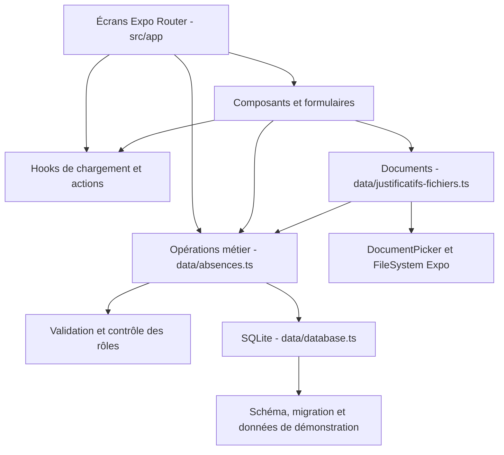

# Architecture du projet

## Objectif

Garder une structure lisible pour une application mobile pédagogique locale. Les écrans, composants, règles, modèles, initialisation de base et fichiers sont séparés. Il n'y a pas de serveur ni d'API distante.

## Couches

| Module                                   | Responsabilité                                                                            |
| ---------------------------------------- | ----------------------------------------------------------------------------------------- |
| `src/app/`                               | Navigation et composition des écrans ; un fichier de route représente un écran            |
| `src/components/ui/formulaire.tsx`       | Présentation partagée : boutons, champs, choix, page et chargement                        |
| `src/components/absence-formulaires.tsx` | Dépôt, décision, correction et annulation d'une absence                                   |
| `src/data/models.ts`                     | Types TypeScript : compte, rôle, groupe, étudiant, séance, absence et statistiques        |
| `src/data/validation.ts`                 | Validation du format des champs, dates/heures et contrôle du rôle                         |
| `src/data/database.ts`                   | Connexion unique réutilisée, schéma, migration et initialisation des séances              |
| `src/data/absences.ts`                   | Point d'entrée des opérations de l'application et requêtes paramétrées                    |
| `src/data/demo.ts`                       | Comptes, groupes et effectifs fictifs initiaux                                            |
| `src/data/session.tsx`                   | Compte connecté en mémoire, partagé par contexte React                                    |
| `src/data/justificatifs-fichiers.ts`     | Import du fichier, contrôle de format/taille, copie attendue et ouverture                 |
| `src/hooks/use-donnees.ts`               | Chargement au focus, état d'erreur, nouvelle tentative et ignorance des réponses périmées |
| `src/hooks/use-action.ts`                | Verrou contre le double clic, état occupé et présentation des erreurs                     |

`absences.ts` réexporte les modèles et quelques fonctions de validation pour conserver une API stable pour les écrans existants. Les types sont centralisés dans `models.ts`.

## Tables SQLite

| Table           | Données principales                                        | Relations / contraintes                                     |
| --------------- | ---------------------------------------------------------- | ----------------------------------------------------------- |
| `groupes`       | Identifiant et nom                                         | Nom unique                                                  |
| `etudiants`     | Matricule, nom et groupe actuel                            | Matricule unique, groupe référencé                          |
| `comptes`       | Email, mot de passe local, nom, rôle et matricule éventuel | Email unique ; au plus un compte par matricule              |
| `seances`       | Groupe, enseignant, matière, date et heure                 | Combinaison unique ; groupe et compte enseignant référencés |
| `participants`  | Séance et étudiant inscrit                                 | Clé composée ; conserve les inscriptions historiques        |
| `absences`      | Étudiant, enseignant et contexte de séance                 | Unicité enseignant/étudiant/matière/date/heure              |
| `justificatifs` | Motif, document, statut, décision et date de dépôt         | Une ligne par absence ; suppression en cascade              |
| `lectures`      | Absence déjà consultée par l'étudiant                      | Une ligne par absence ; suppression en cascade              |
| `migrations`    | Numéros des migrations appliquées                          | Initialisation exécutée une seule fois                      |

Les références de l'ancienne table `absences` sont conservées comme champs logiques pour maintenir sa compatibilité. Les opérations métier vérifient les comptes, séances et inscriptions avant les écritures. Les nouvelles tables utilisent les clés étrangères décrites ci-dessus, activées avec `PRAGMA foreign_keys = ON`.

## Migration et transactions

La base s'appelle `gestion-absences.db`. Le schéma initial de l'ancienne application est reconnu sans supprimer ses absences. La migration version 2 initialise les catalogues, reconstitue les séances des absences existantes et ajoute les séances fictives du planning. Son numéro empêche une nouvelle initialisation au prochain démarrage.

La création étudiant/compte, la saisie d'absences, la correction et les décisions utilisent des transactions exclusives. Une erreur annule l'ensemble de l'opération. Les valeurs saisies passent par des paramètres SQL, pas par une concaténation dans la requête.

## Parcours justificatif

1. Le système Android donne accès au document choisi par l'utilisateur.
2. L'application vérifie le format et la taille puis attend sa copie dans le cache propre au projet Expo Go.
3. Au dépôt, elle attend la copie dans les documents persistants avant d'écrire la ligne SQLite.
4. Si l'écriture échoue, elle tente de supprimer cette nouvelle copie sans masquer l'erreur d'origine.
5. Le statut commence à En attente. L'enseignant concerné ou l'administration peut accepter/refuser avec un commentaire.
6. L'étudiant voit uniquement ses propres demandes. Une demande acceptée ne peut plus être remplacée.

Le choix de l'URI Android autorisée évite de dépendre du cache global de DocumentPicker, inaccessible à certaines expériences Expo Go. Le code attend explicitement `File.copy()` : une copie échouée ne doit jamais être annoncée comme un dépôt réussi.

## Statistiques et accès

Le taux brut vaut `absences / inscriptions à des séances commencées × 100`. Les absences acceptées restent incluses, avec leur nombre affiché séparément. Sans séance commencée, le taux est Non calculable. Le global est pondéré par le nombre d'inscriptions.

L'étudiant est filtré par matricule, l'enseignant par email auteur et l'administration dispose de la vue globale. Les contrôles de rôle sont présents dans les opérations d'écriture et les routes sont protégées. Ce mécanisme reste un dispositif de démonstration dans une application locale, pas une frontière de sécurité côté serveur.

## Tests et évolution

`scripts/test-absences.cjs` exécute les opérations réelles sur une base SQLite temporaire sur disque, avec un adaptateur du pont Expo. `scripts/test-justificatifs.cjs` vérifie le séquencement asynchrone et les erreurs de fichiers avec un double natif. TypeScript, ESLint et Prettier complètent ces tests. La recette sur appareil vérifie ce qui ne peut pas être validé par ces doubles.

Pour une version multi-appareils, remplacer le stockage local partagé entre comptes par une API authentifiée, un stockage de documents autorisé et une synchronisation définie. Cette évolution nécessite une nouvelle conception de la sécurité ; elle n'est pas incluse dans ce prototype.
